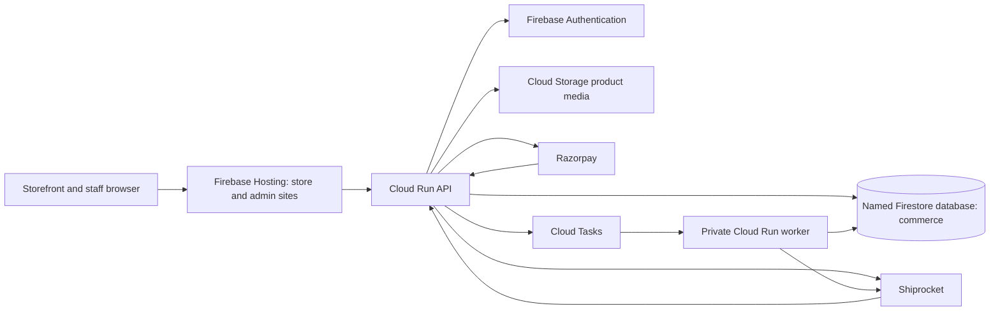

# SPARK DV commerce implementation

This is the existing React/Vite storefront and admin. The separate `Spark DV` Next.js directory is a draft and is not the deployment source for this implementation.

## Architecture



Firestore is canonical for catalog drafts and published products, inventory, page content, promotions, staff grants, customers, carts, preferences, quotes, orders, payments, shipments, and audit events. The browser receives only published catalog and content. Admin writes use server-checked Firebase session cookies and role permissions. Firestore and Storage client rules deny direct data access; the API validates every mutation. Customer and staff sessions use HttpOnly cookies; the Firebase browser SDK uses memory only for the sign-in exchange. No order or cart amount from the browser is trusted at payment time.

Product drafts and page drafts have an explicit publish action. A published online product needs a confirmed HSN code, GST rate, package weight/dimensions, and available inventory. Tax is calculated at checkout based on the delivery state, with separate CGST/SGST or IGST lines. Shiprocket rates are quoted by PIN code. Razorpay webhooks and the checkout callback verify signatures and update Firestore idempotently. Paid orders enter a Cloud Tasks queue, where the worker books the shipment, assigns a tracking number, requests a label and pickup, and records tracking updates. Provider secrets stay on the API and worker.

## Local development

Use Node 24, Java 21, and the repo root. Copy `.env.example` to ignored `.env.local`, then fill Firebase web settings. The current local `.env.local` already contains Firebase web and Razorpay test settings; keep it private. Install and build:

```powershell
npm ci
npm run typecheck
npm run build:surfaces
```

For isolated local testing, start the Firebase Auth, Firestore, and Storage emulators in one terminal:

```powershell
npm run emulators
```

In a second terminal, set the local emulator settings before starting Vite:

```powershell
$env:COMMERCE_FIREBASE_PROJECT_ID='demo-sparkdv'
$env:VITE_FIREBASE_PROJECT_ID='demo-sparkdv'
$env:FIREBASE_AUTH_EMULATOR_HOST='127.0.0.1:9100'
$env:FIRESTORE_EMULATOR_HOST='127.0.0.1:8081'
$env:FIREBASE_STORAGE_EMULATOR_HOST='127.0.0.1:9198'
$env:VITE_FIREBASE_AUTH_EMULATOR_URL='http://127.0.0.1:9100'
npm run dev
```

The storefront is at `http://localhost:5173`. Use `VITE_APP_SURFACE=staff` to run the staff UI locally, or use `http://app.localhost:5173`. The emulator UI is at `http://127.0.0.1:4001`. Set `COMMERCE_OWNER_UID` to the Firebase Auth UID of the local owner user before starting Vite to use admin features.

Preview the existing 17-product import without writes:

```powershell
npm run seed:commerce
```

For an isolated emulator import, run `node scripts/seed-commerce.mjs --apply --publish-enquiry` with the same emulator variables as above. The import preserves existing documents, creates zero stock, and leaves products as enquiry or coming soon. Admin must approve HSN, GST, dimensions, weight, pickup settings, and stock before enabling online checkout. Never infer these from old price labels.

## Production setup

1. Grant the deployment identity access to Firebase project `spark-dv-dealatecorp`. Create the named Firestore database `commerce` in the chosen India region (for example `asia-south1`) if it does not exist. The database name is part of the API contract. Deploy `firestore.rules` and `firestore.indexes.json`. Create a dedicated Firebase Storage bucket for commerce media, verify or replace the planned bucket ID in `.firebaserc`, and deploy `storage.rules` there. Do not replace rules on an existing shared bucket without reviewing its current clients.
2. Enable Firebase Authentication methods and authorized domains used by both sites. Set `COMMERCE_OWNER_UID` to a real Firebase Auth UID. Grant the API and worker service identities only the Firestore, Storage, Cloud Tasks, and Secret Manager permissions they need.
3. Configure a private Cloud Run worker and a public Cloud Run API using this repo's `Dockerfile`. Keep the worker restricted to the Cloud Tasks service account. Set `COMMERCE_WORKER_URL` to the worker base URL, create the `sparkdv-fulfillment` queue in the same region, and configure periodic reservation expiry through the authenticated worker endpoint.
4. Configure Razorpay payment and webhook credentials, then register `/api/payments/webhook`. Configure Shiprocket credentials and a webhook token, then register `/api/shipping/webhook`. Set the pickup location in Shiprocket and the store's GSTIN, origin state, pickup PIN code, shipping GST rate, and pickup address through the owner admin panel. Test payment capture, failed payment, refund, shipment booking, and delivery callbacks in test environments.
5. Create a second Firebase Hosting site for admin, apply Hosting targets `store` and `admin` in `.firebaserc`, build with `npm run build:surfaces`, and deploy both sites. The `firebase.json` rewrites send `/api/**` to the public `sparkdv-api` service in `asia-south1`. The `dist/store` and `dist/admin` bundles select their surface at build time. Add the final site domains to Firebase Auth authorized domains and configure DNS/TLS.
6. Import the 17 products as enquiry catalog entries, review copy/images and published content, then publish online products only after tax, package, inventory, and legal/policy fields are approved. Do not switch on live payments until an end-to-end order has succeeded from quote to delivery webhook.

Useful commands after project access is granted (replace the secondary site ID with an available ID):

```powershell
gcloud firestore databases create --project=spark-dv-dealatecorp --database=commerce --location=asia-south1 --edition=standard --type=firestore-native
npx firebase hosting:sites:create YOUR_ADMIN_SITE_ID --project spark-dv-dealatecorp
npx firebase target:apply hosting store spark-dv-dealatecorp --project spark-dv-dealatecorp
npx firebase target:apply hosting admin YOUR_ADMIN_SITE_ID --project spark-dv-dealatecorp
npx firebase target:apply storage media YOUR_DEDICATED_MEDIA_BUCKET --project spark-dv-dealatecorp
npm run build:surfaces
npx firebase deploy --only firestore:commerce,storage,hosting --project spark-dv-dealatecorp
```

Creating the database or Hosting site is a one-time action. Inspect existing resources first. Deploying rules overwrites the deployed rules for those resources. The current signed-in `gcloud` account cannot list databases in this project, so these production steps have not run.

## Required configuration

See `.env.example` for the complete key list. Browser settings are the four `VITE_FIREBASE_*` web fields. Server settings are `COMMERCE_*`, Firebase application credentials supplied through the Cloud Run identity, Razorpay and Shiprocket secrets, and optional Resend email settings. Never place secrets in `VITE_*`, commit `.env.local`, or use a Firebase service-account JSON key in the browser.

## Migration boundary

The old Vite checkout contained SQL-backed auth/orders and WhatsApp order submission. New commerce routes use Firestore and Firebase Auth. Legacy SQL endpoints remain in source for historical compatibility but `COMMERCE_ALLOW_LEGACY_SESSION=0` keeps them out of new staff authorization. Remove them after production data migration and acceptance testing. The Next.js draft is not used as a second live storefront.
